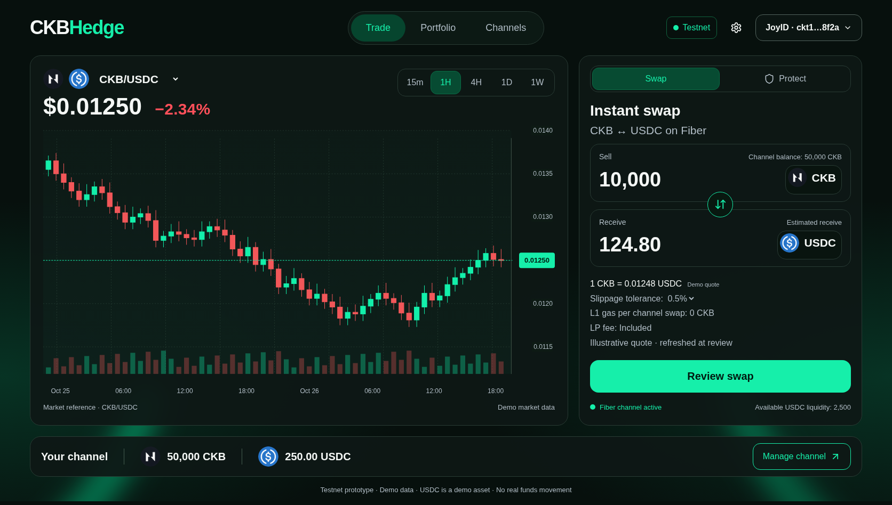

# CKBHedge

A web-based CKB hedging and instant-swap terminal designed for the Nervos Fiber Network.

CKBHedge helps ecosystem builders, grant recipients, and traders explore ways to protect CKB holdings during market volatility. It combines two-way swaps, manual hedging, rule-based protection, and channel liquidity management in one interface.

> **Current status: frontend prototype.** All balances, quotes, charts, wallet interactions, swaps, and authorizations are simulated. This repository does not connect to a blockchain, sign transactions, or move funds.



## Why CKBHedge?

Teams holding grants or operating funds in CKB are exposed to price changes while they wait for on-chain transactions or exchange deposits. The product described in the PRD aims to offer a browser-based, non-custodial alternative using pre-funded Fiber payment channels.

The planned system targets low-latency off-chain swaps without an L1 miner fee for each in-channel swap. Channel funding and settlement would still require on-chain transactions, and execution would depend on liquidity. These are product goals, not capabilities demonstrated by this frontend.

## Features

| Page                       | Frontend capabilities                                                                                                                                                          |
| -------------------------- | ------------------------------------------------------------------------------------------------------------------------------------------------------------------------------ |
| **Trade**                  | CKB ↔ USDC demo swaps, amount and percentage controls, direction reversal, slippage selection, quote review, and simulated results.                                            |
| **Protect** (within Trade) | Manual percentage hedges; stop-loss, trailing-stop, and simulated AI signal settings; notification or automatic execution policies; spending limits and session expiry review. |
| **Portfolio**              | Demo asset balances, allocation and protection summaries, activity details, and protection management controls.                                                                |
| **Channels**               | Demo channel status, local capacity and liquidity, setup and funding dialogs, channel closure, and activity history.                                                           |

The shared interface includes responsive navigation, accessible dialog and tab primitives, local token logos, and a subtle green aurora background with reduced-motion support.

### Asset and market data

The original PRD proposes **CKB ↔ RUSD**. This frontend follows the supplied visual references and uses **CKB ↔ USDC** as a demo pair instead. USDC support on the intended network has not been verified.

Candles and quotes are synthetic. The CKB/USDC chart is not a relabeled CKB/USDT market feed. The AI Signal option does not connect to an AI model.

## Getting started

### Requirements

- Node.js **20.9 or newer**
- npm

### Installation

```sh
git clone https://github.com/rikokurnia/ckbhedge.git
cd ckbhedge
npm ci
npm run dev
```

Open [http://localhost:3000](http://localhost:3000). The home route redirects to `/trade`.

No environment variables, wallet, API keys, or local blockchain node are required for this demo.

### Available commands

| Command             | Purpose                                    |
| ------------------- | ------------------------------------------ |
| `npm run dev`       | Start the development server.              |
| `npm run typecheck` | Run TypeScript checks.                     |
| `npm run build`     | Create a production build.                 |
| `npx next start`    | Serve the production build after building. |

## Project structure

```text
app/
  layout.tsx              Shared application shell
  globals.css             Design tokens and shared styling
  trade/                  Trade route
  portfolio/              Portfolio route
  channels/               Channels route
components/
  shared/                 Navigation, background, and reusable UI
  trade/                  Swap, protection, and demo chart
  portfolio/              Portfolio views and interactions
  channels/               Channel management views and dialogs
lib/demo.ts               Shared typed demo contracts and fixtures
public/tokens/            Local token assets and source attribution
artifacts/                Trade screenshots
```

**Stack:** Next.js App Router, React, TypeScript, Tailwind CSS v4, Radix UI primitives, and Lucide icons. The current chart is a custom SVG visualization with responsive HTML labels.

## Demo behavior and limitations

- The displayed JoyID identity is a placeholder; no wallet authentication occurs.
- Swap and manual hedge confirmations update local demo balances only.
- Protection rules do not monitor prices or execute in the background. Authorization does not generate session keys or grant wallet access.
- Trade and Portfolio state is local to their views and resets when remounted. Channels stores its demo state in browser local storage. The pages do not share a synchronized ledger.
- Funding, faucet, and settlement interactions are simulations. Displayed transaction identifiers are not on-chain records.
- No JoyID SDK, Fiber client, RPC/indexer, live market feed, or RFQ backend is integrated.

## Roadmap

The PRD outlines the following integration work beyond this prototype:

1. **Testnet core:** JoyID passkey authentication, verified asset support, Fiber client integration, channel funding, and manual swaps on CKB Testnet.
2. **Market data and automation:** correctly identified market feeds, an RFQ quote service, scoped session-key authorization, and a rule watcher for stop-loss and trailing protection.
3. **Hardening:** liquidity checks, reconnection and transaction reconciliation, session revocation, settlement handling, and end-to-end testnet validation.

The intended architecture connects the browser terminal to JoyID and a Fiber client, with backend quoting and protection services coordinating liquidity providers and market data. That infrastructure is not included here.

## Development notes

See [HANDOFF.md](HANDOFF.md) for shared component imports, data contracts, and module ownership. Token asset attribution is recorded in [public/tokens/SOURCES.md](public/tokens/SOURCES.md).

For contributions, keep simulated behavior explicit, preserve keyboard accessibility and reduced-motion support, and run `npm run typecheck` and `npm run build` before submitting changes.
